# ha-timer-card

[](https://www.home-assistant.io/integrations/marketplace/)
[](https://github.com/juju35/ha-timer-card/actions/workflows/hacs.yml)
[](https://github.com/juju35/ha-timer-card/actions/workflows/validate.yml)
[](https://github.com/juju35/ha-timer-card/actions/workflows/lint.yml)
[](https://github.com/juju35/ha-timer-card/releases/latest)
[](https://github.com/juju35/ha-timer-card/blob/main/LICENSE)
[](https://buymeacoffee.com/julienstep9)

<p align="center"></p>

<p align="center">
  <a href="https://www.home-assistant.io/integrations/timer/"></a>&nbsp;&nbsp;
  <a href="https://github.com/leikoilja/ha-google-home"></a>&nbsp;&nbsp;
  <a href="https://github.com/alandtse/alexa_media_player"></a>&nbsp;&nbsp;
  <a href="https://www.home-assistant.io/integrations/alexa_devices/"></a>
</p>

Lovelace cards for Home Assistant for **timers and counters**: [timer helpers](https://www.home-assistant.io/integrations/timer/) you start, pause, resume, extend and cancel from the card, the timers set on **Google Home** speakers ([Google Home community integration](https://github.com/leikoilja/ha-google-home)) and on **Echo** devices ([Alexa Media Player](https://github.com/alandtse/alexa_media_player) or the core [Alexa Devices](https://www.home-assistant.io/integrations/alexa_devices/)), with **live countdown rings**, **quick starts**, and [counter helpers](https://www.home-assistant.io/integrations/counter/) with − and + buttons.

Timers, speaker timers and counters are **discovered automatically** from the Home Assistant entity registry: an empty configuration already shows them, whatever your Home Assistant language or entity ids. Each of them can also be listed in the configuration.

[](https://my.home-assistant.io/redirect/marketplace_repository/?owner=juju35&repository=ha-timer-card&category=plugin)

| Timer Card | Timer Mini Card |
|---|---|
| 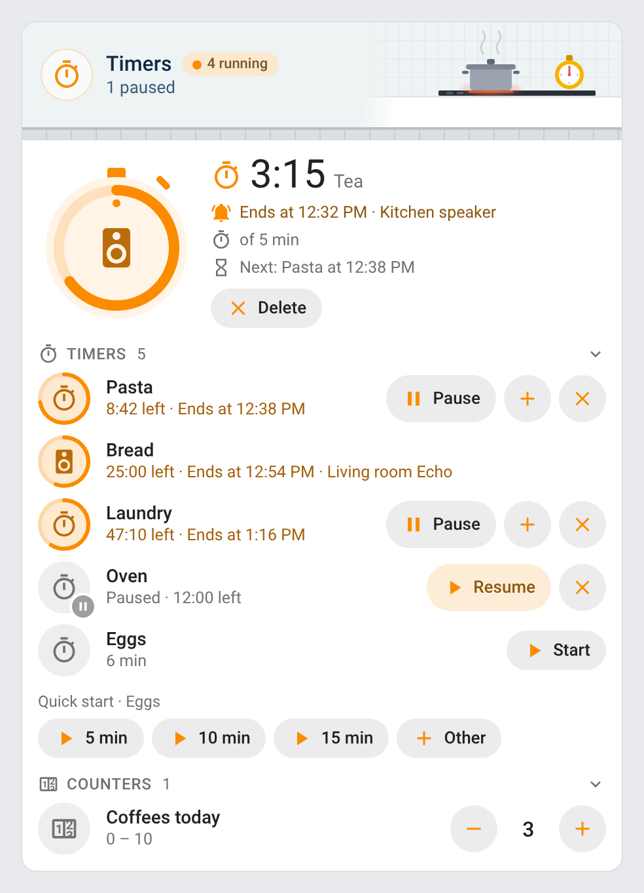 | 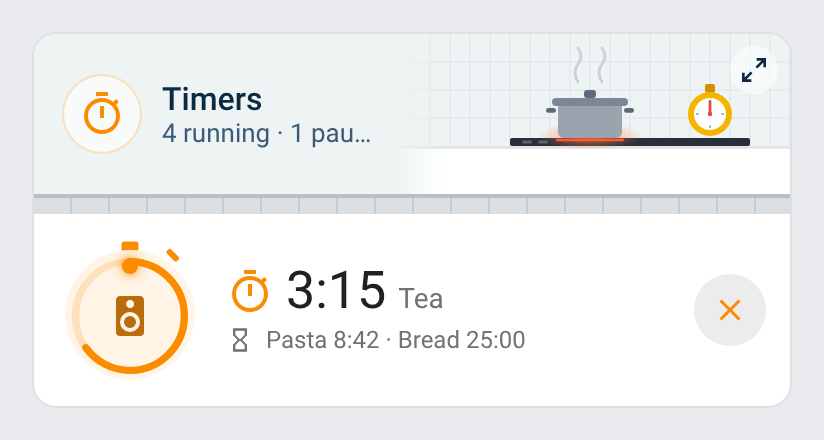<br>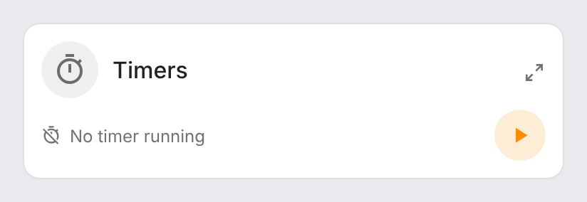 |

## Features

- Two cards: a full **Timer Card** (`custom:timer-card`) and a compact **Timer Mini Card** (`custom:timer-mini-card`)
- The **next timer to end in large**: a dial whose ring empties second by second, the time left inside, its length, the time it ends and the speaker it rings on; a dot sweeps round the dial while it runs, the dial flashes and a bell shakes when a speaker timer rings (see [Animations](#animations))
- **Every timer** in a list, ringing first, then running (the next to end first), paused and idle, each with its own ring and live countdown
- **Timer helpers**: Pause, Resume, *Add a minute* (`timer.change`), Cancel, and Start with a popup at the top of the card to pick the duration (presets 1 to 60 minutes, or minute by minute)
- **Quick starts**: 5, 10 and 15 minutes (or *Other*) on the idle timer helper of your choice
- **Google Home timers**: label, time left, the speaker; *Delete* (or *Stop* while it rings) with `google_home.delete_timer`
- **Alexa timers**: label, time left and length from Alexa Media Player's next-timer sensors; the next timer's end from Alexa Devices (core)
- **Counters**: value, bounds, and − / + buttons (`counter.decrement` / `counter.increment`), disabled at the bounds
- Header icon in a tinted round badge (orange running, red ringing, grey idle), and a status chip on the title's line: *3 running*, *Ringing*, *Paused*
- Collapsible sections (timers, counters), folded back to their defaults by a click elsewhere on the page
- Click any timer or counter to open its Home Assistant history (more-info dialog)
- Detail button on the mini card (top right): it switches the mini card to the full card's content and back; a click anywhere outside the card brings the compact view back
- Visual editor in the dashboard UI for both cards (no YAML needed)
- Light and dark mode, English, French, German, Spanish, Serbian (Cyrillic and Latin), Italian, Dutch, European Portuguese, Polish, Romanian, Danish, Swedish, Bulgarian, Russian, Ukrainian, Hungarian, Slovak, Czech, Slovenian, Latvian and Greek
- Single file, no external dependency

## Supported integrations

| Integration | What the cards use |
|---|---|
|  [Timer](https://www.home-assistant.io/integrations/timer/) (core helper) | State (`active`, `paused`, `idle`), `duration`, `remaining`, `finishes_at`; `timer.start` (with a duration), `timer.pause`, `timer.change`, `timer.cancel` |
|  [Counter](https://www.home-assistant.io/integrations/counter/) (core helper) | Value, `minimum`, `maximum`, `step`; `counter.increment`, `counter.decrement` |
|  [Google Home](https://github.com/leikoilja/ha-google-home) (custom, `google_home`) | The *timers* sensor of each speaker: its `timers` attribute (label, `local_time_iso`, `duration`, `remaining` when paused, `status` set / ringing / paused); `google_home.delete_timer` |
|  [Alexa Media Player](https://github.com/alandtse/alexa_media_player) (custom, `alexa_media`) | The *next timer* sensor of each Echo: its `sorted_active` attribute (`timerLabel`, `remainingTime` at `process_timestamp`, `originalDurationInMillis`, `status` ON / PAUSED), else its state (the time the next timer ends); older formats (`sorted_active` as a JSON string or as `[id, timer]` pairs) are read too |
|  [Alexa Devices](https://www.home-assistant.io/integrations/alexa_devices/) (core, `alexa_devices`) | The *next timer* sensor of each Echo (timestamp): the time the next timer ends, without label, length or pause |

Helpers and speaker timers are found on their own, sorted by name. Details in [How it works](#how-it-works).

## Prerequisites

Home Assistant 2024.8 or later, with at least a timer or counter helper, or a speaker of the integrations above.

## Installation

### Via the Marketplace (recommended)

Click the button below to add the repository directly:

[](https://my.home-assistant.io/redirect/marketplace_repository/?owner=juju35&repository=ha-timer-card&category=plugin)

Then click **Install**, and reload your browser when the Marketplace asks you to.

Or manually:

1. Open **Settings → Marketplace → Add from link** (top right; this needs a GitHub account connected)
2. Add `https://github.com/juju35/ha-timer-card` — Type: **Dashboard**
3. Open **Timer Card** and click **Install**
4. Clear your browser cache and refresh

The Marketplace adds the resource `/local/community/ha-timer-card/timer-card.js` for you.

### Manual

1. Download `timer-card.js` and the `timer-card.i18n.*.js` translation files from the [latest release](https://github.com/juju35/ha-timer-card/releases/latest)
2. Copy them all to `/config/www/` (without the translation files, the cards show in English)
3. Go to **Settings → Dashboards → ⋮ → Resources** → Add resource:
   - URL: `/local/timer-card.js`
   - Type: **JavaScript Module**
4. Clear your browser cache and refresh

## Configuration

### Card types

| Card | Type |
|---|---|
| Timer Card | `custom:timer-card` |
| Timer Mini Card | `custom:timer-mini-card` |

### Visual editor

Edit a dashboard, click **Add card** and search for **Timer Card** or **Timer Mini Card**. Everything is discovered when the lists are left empty; pick timers (timer helpers and speaker timer sensors) and counters to show only those, the timer of the quick starts, the sections and the language. The preview updates live, and options left at their default are kept out of the generated YAML.

### Minimal

```yaml
type: custom:timer-card
```

```yaml
type: custom:timer-mini-card
```

### Full options

```yaml
type: custom:timer-card
title: Kitchen
timers:
  - timer.pasta
  - entity: sensor.kitchen_speaker_timers
    name: Kitchen speaker
  - sensor.living_room_echo_next_timer
counters:
  - counter.coffees_today
quick_timer: timer.eggs
show_title: true
show_subtitle: true
show_hero: true
show_timers: true
show_quick: true
show_counters: true
collapsed:
  - counters
language: en
```

```yaml
type: custom:timer-mini-card
quick_timer: timer.eggs
zoom: true
```

### Options reference

| Option | Card | Default | Description |
|---|---|---|---|
| `title` | both | Timers | Card title |
| `show_title` | both | `true` | Show the title in the header |
| `show_subtitle` | full | `true` | Show the subtitle (how many timers run and are paused) |
| `timers` | both | Automatic | Timer helpers (`timer.*`), Google Home *timers* sensors and Alexa *next timer* sensors: entity ids, or objects with `entity` and `name` (the name of a speaker timer without a label); absent, every timer helper and speaker timer sensor |
| `counters` | both | Automatic | Counter helpers: entity ids, or objects with `entity` and `name`; absent, every counter helper; `[]` for none |
| `quick_timer` | both | First idle helper | Timer helper the quick starts (and the mini card's start button) start |
| `show_hero` | both | `true` | The next timer to end, in large |
| `show_timers` | both | `true` | Timers section |
| `show_quick` | both | `true` | Quick starts (5, 10, 15 min, Other) |
| `show_counters` | both | `true` | Counters section |
| `collapsed` | both | `[]` | Sections folded by default, among `timers` and `counters`. Click a section title (or Tab to it and press Enter or Space) to fold or unfold it |
| `zoom` | mini | `true` | Detail button at the top right of the mini card: it shows the full card's content (with the same options, which can be set on the mini card too, in its visual editor as well) and switches back to the compact view; a click outside the card also brings the compact view back. `false` removes the button |
| `language` | both | Auto | Force language: `fr`, `en`, `de`, `es`, `sr`, `sr-Latn`, `it`, `nl`, `pt`, `pl`, `ro`, `da`, `sv`, `bg`, `ru`, `uk`, `hu`, `sk`, `cs`, `sl`, `lv` or `el` (auto-detects from HA settings) |

`timers` and `counters` as objects are YAML only; the visual editor edits them as lists of entities.

## Screenshots

### Animations

The dial of the next timer animates; every animation honours `prefers-reduced-motion`.

While it runs, a dot sweeps round the dial (and the ring empties second by second in Home Assistant):

| Light | Dark |
|---|---|
| 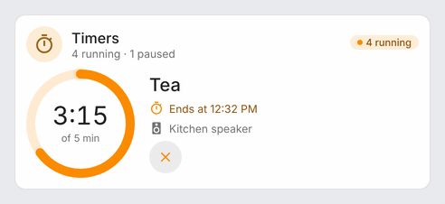 | 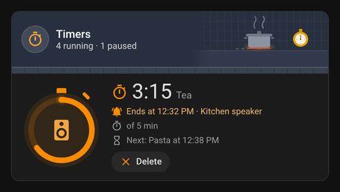 |

When a speaker timer rings, its dial and ring flash and a bell shakes:

| Light | Dark |
|---|---|
| 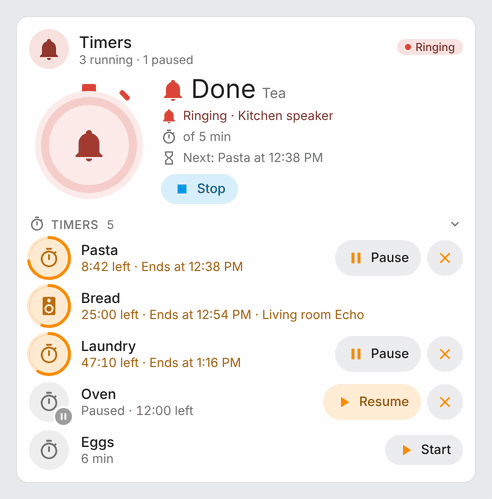 | 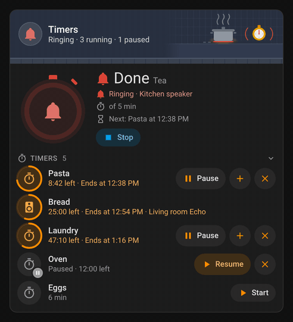 |

### Full card

The tea timer of the kitchen speaker ends first; pasta and laundry run, the bread timer runs on the Echo, the oven is paused, eggs are ready to start:

| Light | Dark |
|---|---|
|  | 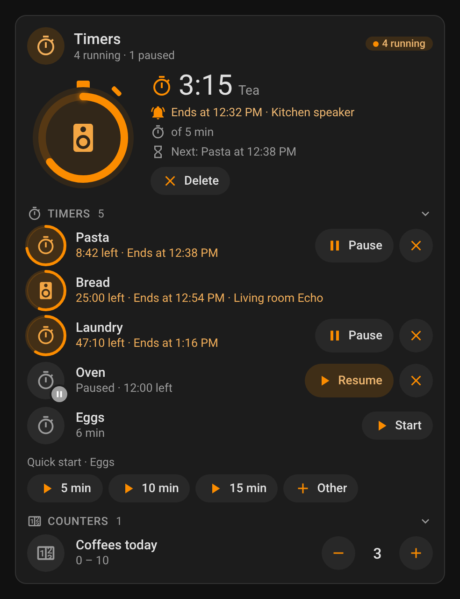 |

Start on a timer helper: the duration popup, at the top of the card:

| Light | Dark |
|---|---|
| 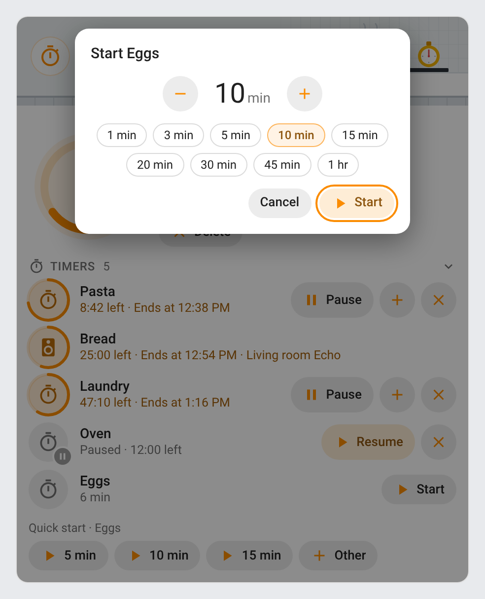 | 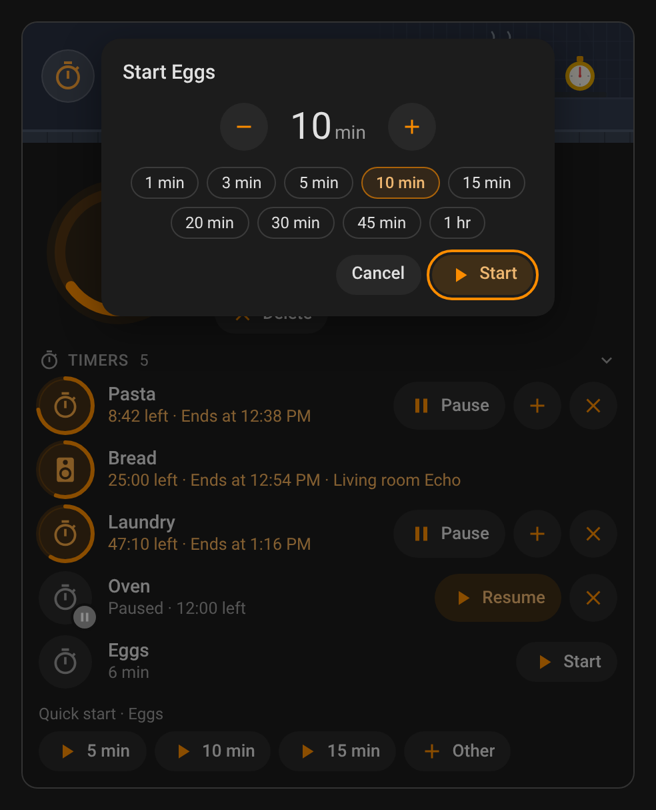 |

Nothing running: the quick starts stay at hand:

| Light | Dark |
|---|---|
| 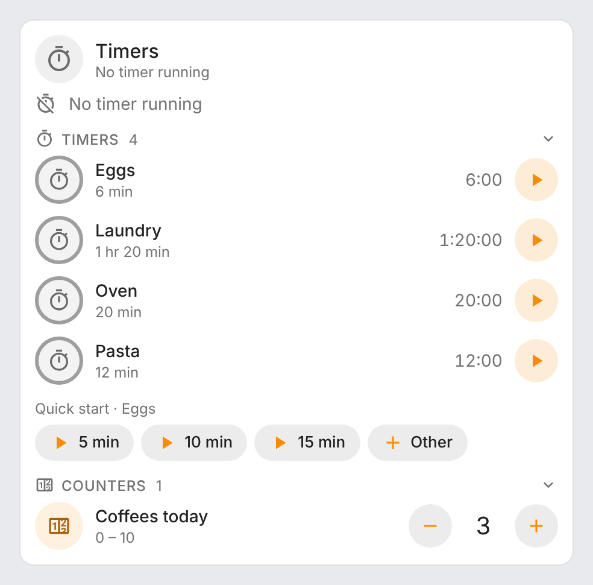 | 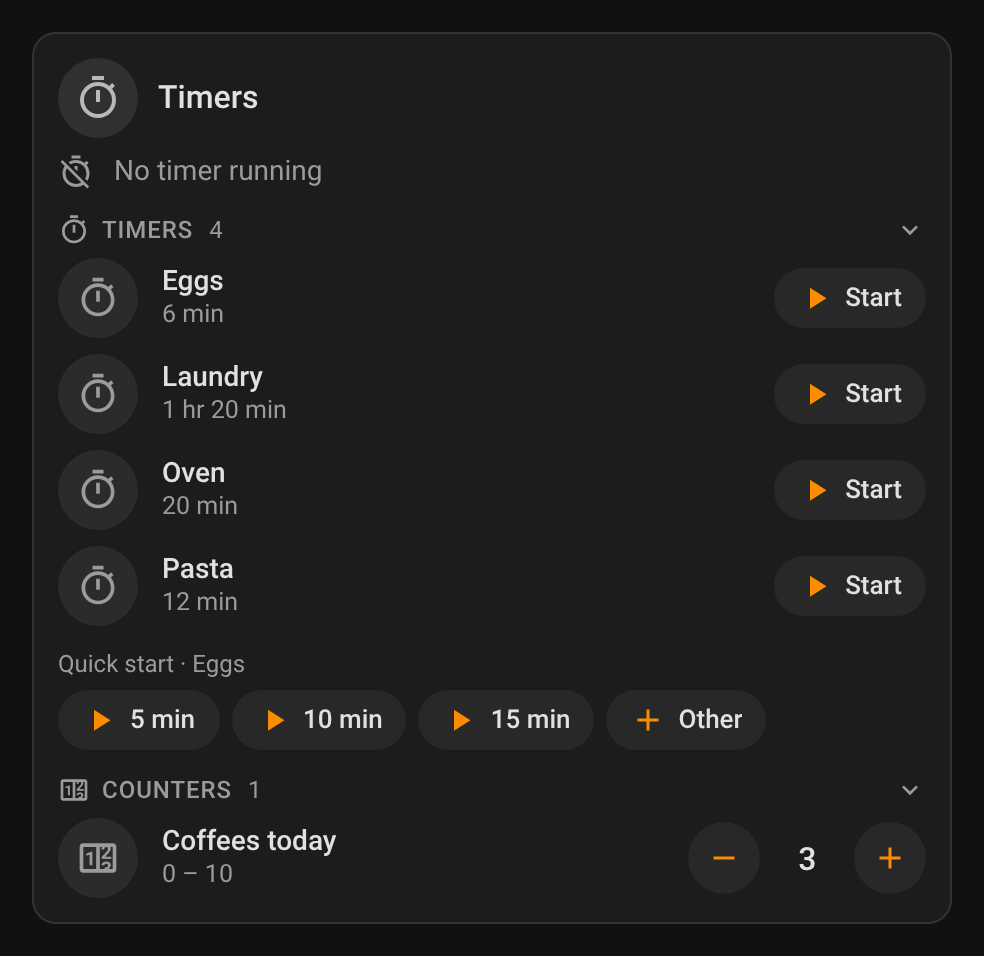 |

### Mini card

| Light | Dark |
|---|---|
|  | 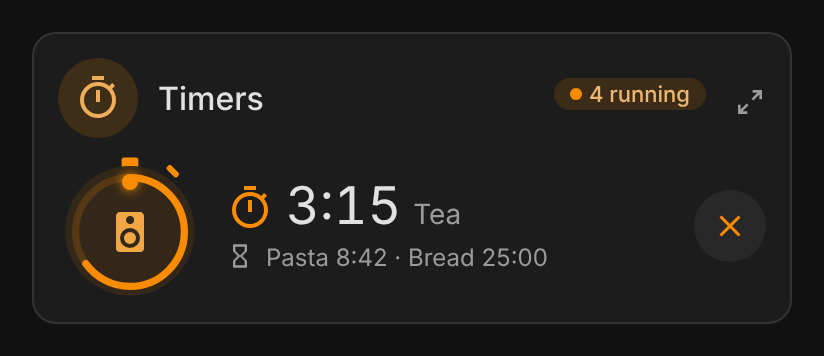 |
|  | 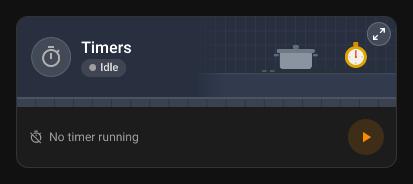 |

The detail button (top right) shows the full card's content:

| Light | Dark |
|---|---|
| 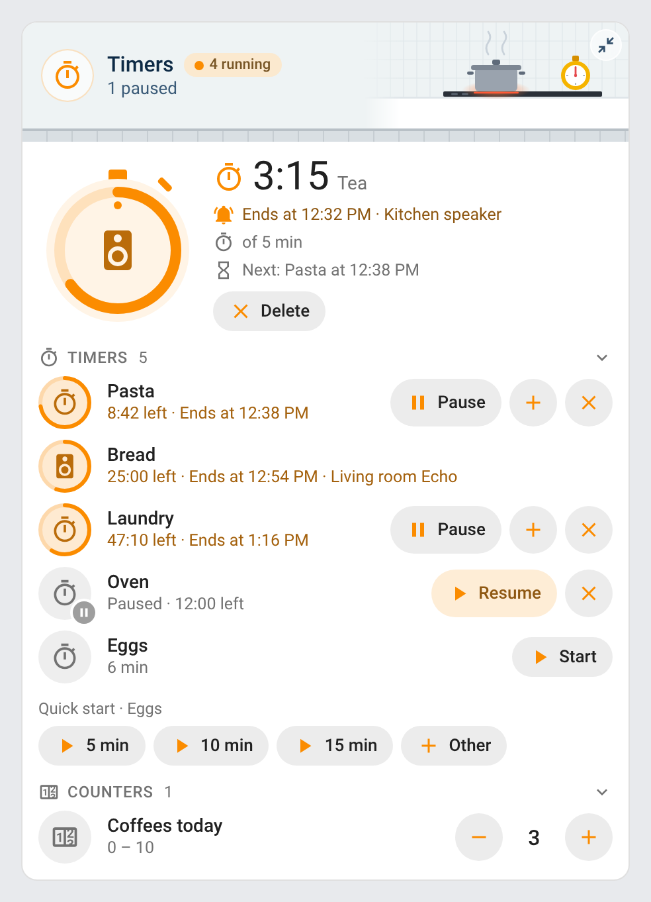 | 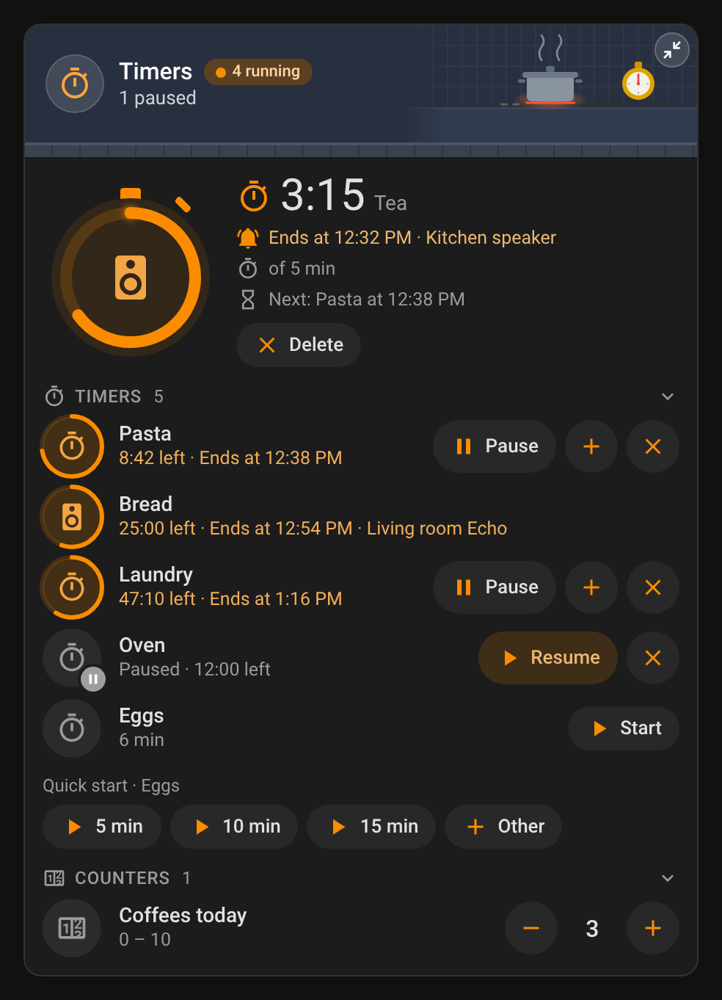 |

### Narrow cards

The full card at 6 columns of a phone's Sections view (the dial above its texts, one button per timer) and the mini card at its minimum width:

| Light | Dark |
|---|---|
| 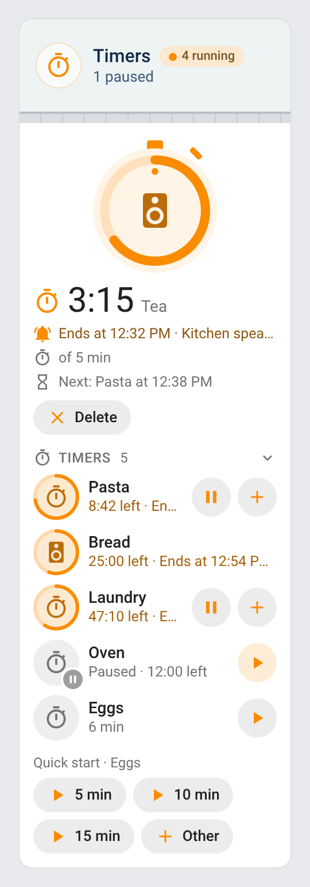 | 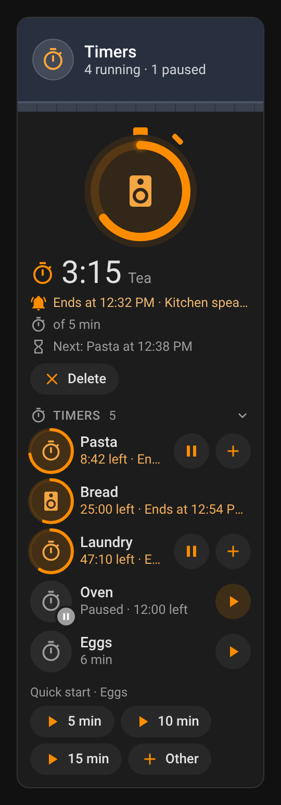 |
| 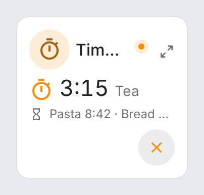 | 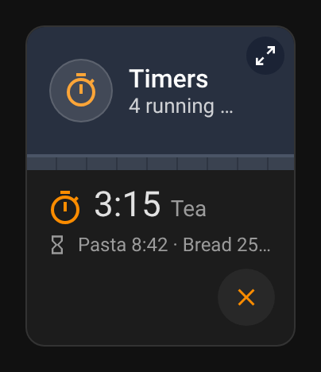 |

## How it works

The cards read the Home Assistant entity registry instead of relying on entity ids: a speaker timer sensor is a sensor of the `google_home` integration whose translation key is *timers*, of `alexa_media` whose translation key is *next timer*, or of `alexa_devices` whose translation key is *timer* (its alarm and reminder sensors are left out). Entity ids can therefore be in any language or renamed.

- **Countdown**: the time a timer ends (`finishes_at`, Google's `local_time_iso`, Alexa's time left counted from `process_timestamp`); the texts and rings move every second in place, without redrawing the card, and the card is redrawn once a countdown ends. A paused timer shows the time it has left.
- **Ring**: what is left of the timer's length (`duration`, Google's `duration`, Alexa's `originalDurationInMillis`).
- **Ringing**: a Google Home timer whose status is *ringing*, or a speaker timer whose end has gone by. Timer helpers do not ring: once done they go back to idle (and fire `timer.finished`).
- **Quick starts** call `timer.start` with the duration on the `quick_timer` (else the first idle timer helper); *Other* opens the duration popup.

## Development

```bash
npm install
npm run build        # bundles src/timer-card.js into dist/timer-card.js (and its translation files)
npm run check        # builds and checks the card (run in CI)
npm test             # unit tests
npm run screenshots  # renders the cards (and one GIF per animated state, needs ffmpeg) with mock data into screenshots/
```

`dist/` is not committed: `npm run build` creates it locally, CI builds it on every push, and the release workflow attaches the built files to the release, which is where the Marketplace installs it from. The captures are rendered on a fixed clock with mock data (scripts/mock-states.mjs) and rewritten only when their pixels change, exactly; on a pull request, the **Screenshots** workflow commits them to the pull request's branch.

### Releasing

1. Bump `version` in `package.json` (and `package-lock.json`, with `npm install`)
2. Add a `## <version>` section at the top of [CHANGELOG.md](https://github.com/juju35/ha-timer-card/blob/main/CHANGELOG.md)
3. Push to `main`: the **Release** workflow builds the card, creates the tag and the GitHub release with the changelog section as notes, and attaches `timer-card.js` and its translation files

## Translations

The cards auto-detect the language from your Home Assistant settings. Currently supported:

| Language | Code |
|---|---|
| English | `en` |
| Français | `fr` |
| Deutsch | `de` |
| Español | `es` |
| Српски | `sr` |
| Srpski (latinica) | `sr-Latn` |
| Italiano | `it` |
| Nederlands | `nl` |
| Português (European; also used for `pt-BR`) | `pt` |
| Polski | `pl` |
| Română | `ro` |
| Dansk | `da` |
| Svenska | `sv` |
| Български | `bg` |
| Русский | `ru` |
| Українська | `uk` |
| Magyar | `hu` |
| Slovenčina | `sk` |
| Čeština | `cs` |
| Slovenščina | `sl` |
| Latviešu | `lv` |
| Ελληνικά | `el` |

English is in the card's file; every other language is in its own small file (`timer-card.i18n.<lang>.js`), loaded only when needed. Contributions for additional languages are welcome!

## Credits

Google Home is a trademark of Google LLC; Alexa and Echo are trademarks of Amazon.com, Inc. This project is not affiliated with any of them. Icons from [Material Design Icons](https://pictogrammers.com/library/mdi/).

## License

[MIT](https://github.com/juju35/ha-timer-card/blob/main/LICENSE)

## Support

If you find this project useful, you can support its development:

<a href="https://buymeacoffee.com/julienstep9"></a>
